# 1. Problem statement and objectives

After every delivery of the second innings of an ODI, can we estimate whether the chasing team will win? The project builds one pipeline for this single task: (i) validate and reconstruct the ball-by-ball data, (ii) build a leakage-safe match-state dataset, (iii) mine association rules that describe which match-state conditions go with winning or losing chases, (iv) train and compare classifiers under match-wise validation, and (v) test whether recent-scoring (momentum) and context features add measurable predictive value.

**Scope and honesty statement.** Only the three 2023 ICC Men's Cricket World Cup files were used. The tournament has 48 matches, so every result below is an *exploratory estimate for this tournament*, not evidence about ODI cricket in general. Delivery rows from one chase share one outcome and are strongly dependent, so all evaluation is grouped by match. This is not a "big data" dataset (26,119 rows, 3.7 MB) and nothing here demonstrates large-scale generalisation.

# 2. Background

Win-probability models for limited-overs cricket have long been built from the resources remaining (balls and wickets), the best-known example being the Duckworth–Lewis method (Duckworth & Lewis, 1998) for reduced-overs targets. Here the required run rate, wickets in hand and balls remaining are the natural baseline state variables; the question is whether additional recent-scoring features help beyond them. Association rules (Agrawal & Srikant, 1994) are used descriptively; FP-Growth (Han, Pei & Yin, 2000) is compared with Apriori. Because observations are clustered in matches, validation follows the logic of blocked cross-validation for hierarchically structured data (Roberts et al., 2017). Probabilities are assessed with the Brier score (Brier, 1950) and reliability curves; Platt scaling (Platt, 1999) is tried for calibration. This background is deliberately short and no systematic literature search was performed.

# 3. Dataset

| File | Shape | Role |
|---|---|---|
| deliveries.csv | 26,119 × 22 | ball-by-ball events (source of all features) |
| matches.csv | 48 × 18 | toss, venue, winner and margin (labels and pre-match context) |
| points_table.csv | 10 × 11 | group-stage standings; context only |

Full column lists, types and missing-value counts are in `DATA_SCHEMA.md`. Key schema facts checked against the files:

* `deliveries.match_id` (1–48) equals `matches.match_number`; team names are consistent in all three files.
* Runs per delivery = `runs_off_bat + extras`; `extras` equals the sum of the five extras columns on every row. A legal ball has no wide and no no-ball.
* The `ball` column is not a legal-ball counter: wides and no-balls consume numbers (e.g. 9.7–9.9), and the 10th delivery of an over is stored as x.1 by float truncation (6 occurrences). The single "duplicate row" found by a naive duplicate check (match 21) is this artefact. Legal balls are therefore counted from file order, which is chronological.
* Wickets: `retired hurt` is not a dismissal, and one delivery (match 38) holds two dismissals (a catch and a "timed out" batter).
* There is no target, target-overs or DLS column. The target is the first-innings total + 1 (known when the chase starts). The overs limit is 300 legal balls unless the first innings stopped early without being all out (only match 15: 258 balls, 43 overs).
* `points_table.csv` covers group matches only (its `Won` equals group-stage wins in `matches.csv`), has no delivery information, and its end-of-tournament standings include the very matches being predicted, so it is used for no feature or label.

**Validation of reconstructed totals.** For the 23 matches won by the defending side, first-innings total minus chase total equals `winner_runs` in 23/23. For the 24 included chasing wins, 10 minus wickets lost equals `winner_wickets` in 24/24.

**Exceptional outcomes.** No match is a tie, no-result or abandoned (every match has a winner; Tie = No Results = 0 in the points table). One match is excluded: match 35 (Pakistan v New Zealand) is recorded as a chasing win with `winner_runs = 21` although the chase finished on 200 against a first innings of 401, i.e. a DLS-type result whose revised target is not in the data, so its label cannot be verified from the files. The binary task therefore uses **47 matches: 24 chasing wins and 23 losses** (Figure 1).

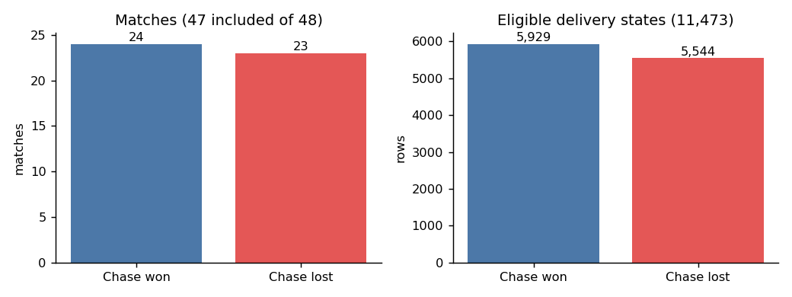{width=80%}

# 4. Methodology

## 4.1 State construction and leakage policy

One row per delivery of each included chase, describing the state *after* that delivery. Every feature is computed from deliveries up to and including the current one. The label is the chasing team's eventual win and is only ever used as `y`. Never used as inputs: `winner`, `winner_runs`, `winner_wickets`, `player_of_match`, final totals, anything from `points_table`.

Eligibility policy: of 11,568 chase deliveries in the included matches, 47 are removed as terminal (the last delivery of every innings, which includes all target-reached and all-out states) and 48 further non-terminal states are removed as mathematically impossible to win (runs required > 6 × balls remaining). **11,473 eligible rows remain** (about 51.7% from chases that were won).

Features: basic state (runs, wickets, wickets remaining, legal balls bowled and remaining, target, runs required, current and required run rate, their difference, share of innings completed); momentum (runs in the last 6/12/30 legal balls, the corresponding rates, wickets and boundaries in the last 12/30, dot-ball share in the last 12, the change in rate between the last 12 balls and earlier play, and the last-12/30 rate minus the required rate; windows are shortened early in the chase); context (chaser won toss, venue, batting team, bowling team). Boundaries are approximated as 4 or 6 runs off the bat because the data carry no boundary flag.

## 4.2 Association rule mining

Transactions are the end-of-over live states with at least 18 legal balls bowled (1,747 transactions from all 47 matches), one per over to reduce within-match repetition. Items: stage of chase (early/middle/late thirds), required run rate (low ≤ 5.5, medium 5.5–8, high > 8), wickets remaining (few ≤ 3, moderate 4–6, many ≥ 7), momentum (change in rate: negative < −1, stable, positive > +1), pace versus requirement (last-12 rate minus required rate: behind < −1, level, ahead > +1) and the outcome. Apriori (level-wise with join and prune) and FP-Growth were implemented from scratch because mlxtend was unavailable. Rules have the form *conditions → outcome*, with minimum support 0.05, confidence 0.60, lift 1.15 and at least 10 distinct matches. Support, confidence and lift are reported with the number of matches covered, the match-level precision (share of covered matches whose final outcome equals the consequent) and a match-cluster bootstrap (300 resamples) 5th percentile of confidence and lift. These rules are descriptive, mined on all 47 matches, and were not used as classifier inputs.

## 4.3 Classification and validation

Models: majority-class and always-win dummies; logistic regression (scaled, balanced class weights, C = 1); Gaussian Naive Bayes; Decision Tree (balanced weights; depth {3, 5, 8} × minimum leaf {50, 200} chosen by an inner 3-fold GroupKFold on training matches using Brier score); Random Forest (150 trees, depth 12, minimum leaf 25, √p features, balanced-subsample weights; fixed a priori, not tuned). Scaling and one-hot encoding sit inside pipelines fitted on training folds only. No resampling was used.

Validation: repeated grouped 5-fold cross-validation, 5 repeats, with whole matches assigned to folds (shuffled each repeat, seed 42). Each outer training set holds 37–38 matches (15–22 chasing wins) and each test fold 9–10 matches (2–9 chasing wins). Metrics are computed on pooled out-of-fold rows per repeat and averaged over the 5 repeats; the SD across repeats reflects partition variability only. Uncertainty from the small number of matches is quantified separately with a match-cluster bootstrap (500 resamples) on repeat-0 predictions. No threshold tuning was done (threshold 0.5).

Ablations: A = basic state; B = A + momentum; C = B + context; D = A + context (to isolate context). Differences are tested with a paired match-cluster bootstrap. Calibration: Random Forest + Platt scaling fitted on inner grouped out-of-fold scores of each training fold. A sanity check refits logistic regression (set B) after randomly shuffling the outcomes across matches.

Because rows from long chases dominate row-level metrics and late states are easy, two supplementary views are reported: match-weighted metrics (each match has total weight 1), and a checkpoint evaluation that takes, for each still-live chase, the first state at or just after fixed overs (10, 20, 30, 40, 45).

# 5. Results

## 5.1 Association rules

131 rules passed the filters (67 → win, 64 → loss; base rate of "win" among transactions 0.519). Apriori and FP-Growth returned identical frequent itemsets and counts at all five thresholds tested (39 to 776 itemsets for minimum support 0.20 down to 0.02); FP-Growth was faster in these implementations (median runtime 4.7 ms vs 19.9 ms at support 0.20, 10.1 ms vs 85.3 ms at 0.05, 13.4 ms vs 154.4 ms at 0.02), Figure 4. With 1,747 transactions both are fast, so the speed difference is not practically important here.

| Rule (antecedent → outcome) | Support | Confidence | Lift | Matches |
|---|---|---|---|---|
| required rate low ∧ middle stage ∧ ≥ 7 wickets left → Win | 0.165 | 1.00 | 1.93 | 21 |
| required rate high ∧ 4–6 wickets left → Loss | 0.113 | 1.00 | 2.08 | 19 |
| required rate high ∧ late stage → Loss | 0.092 | 1.00 | 2.08 | 17 |
| required rate high ∧ ≤ 3 wickets left → Loss | 0.084 | 1.00 | 2.08 | 21 |
| momentum stable ∧ pace ahead (> +1) → Win | 0.080 | 1.00 | 1.93 | 20 |
| required rate low → Win | 0.425 | 0.95 | 1.83 | 26 |
| required rate low ∧ ≥ 7 wickets left → Win | 0.354 | 0.97 | 1.87 | 24 |
| pace behind (< −1) → Loss | 0.381 | 0.79 | 1.64 | 44 |
| ≥ 7 wickets left → Win | 0.422 | 0.67 | 1.29 | 47 |

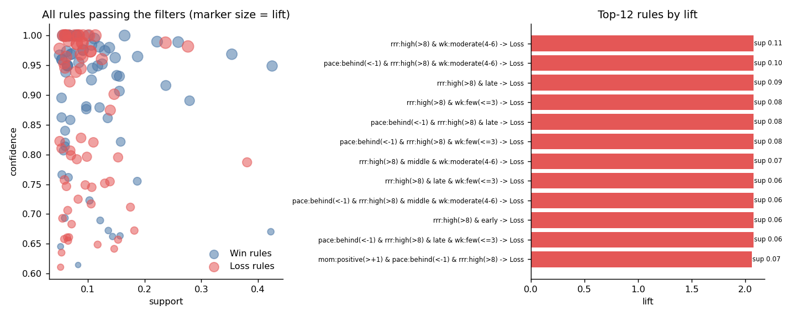

How to read these, and why caution is needed:

* **Lift is capped by the base rate** (about 1.93 for "win" and 2.08 for "loss"). Many rules reach confidence 1.00 and therefore tie at the cap, so ranking by lift alone is uninformative; support and the number of matches covered separate them.
* **Rules are heavily nested and redundant.** Most of the 131 rules are specialisations of a few families: low required rate with wickets in hand → win; high required rate with fewer wickets → loss.
* **Much of this is close to a restatement of the game's arithmetic.** A low required rate (≤ 5.5) is itself the quantity that determines whether a chase is nearly won, so confidence near 1 is expected and does not mean a "discovery".
* **State-level versus match-level.** "Required rate low → Win" covers 26 matches with match-level precision 0.92, but "pace behind → Loss" covers 44 of 47 matches with match-level precision 0.52: almost every chase is behind the rate at some over, so this rule describes states, not matches.
* Momentum items appear mainly in combination with pace versus requirement; momentum alone did not generate rules with strong lift.
* Bootstrap lower bounds (5th percentile) of lift exceed 1 for all 131 rules (for example 1.55 for the first rule above), but the rules were mined and checked on the same 47 matches, so this does not amount to out-of-sample validation. Rules describe association, not causation.

## 5.2 Classification

Mean over 5 repeats of grouped 5-fold CV, delivery-row level, threshold 0.5 (SD across repeats in the supplementary CSV):

| Features | Model | Accuracy | Precision | Recall | F1 | ROC-AUC | PR-AUC | Brier |
|---|---|---|---|---|---|---|---|---|
| — | Always predict win | 0.517 | 0.517 | 1.000 | 0.681 | 0.500 | 0.517 | 0.483 |
| — | Majority of training fold | 0.389 | 0.418 | 0.512 | 0.457 | 0.500 | 0.517 | 0.264 |
| A basic | Logistic regression | 0.908 | 0.914 | 0.908 | 0.911 | 0.962 | 0.971 | 0.073 |
| A basic | Naive Bayes | 0.878 | 0.872 | 0.896 | 0.884 | 0.956 | 0.959 | 0.096 |
| A basic | Decision Tree | 0.857 | 0.875 | 0.845 | 0.859 | 0.875 | 0.855 | 0.126 |
| A basic | Random Forest | 0.901 | 0.921 | 0.884 | 0.902 | 0.946 | 0.957 | 0.079 |
| B +momentum | Logistic regression | 0.900 | 0.910 | 0.895 | 0.902 | 0.961 | 0.969 | 0.076 |
| B +momentum | Naive Bayes | 0.882 | 0.882 | 0.891 | 0.887 | 0.949 | 0.951 | 0.101 |
| B +momentum | Decision Tree | 0.857 | 0.873 | 0.849 | 0.860 | 0.879 | 0.853 | 0.125 |
| B +momentum | Random Forest | 0.898 | 0.915 | 0.885 | 0.900 | 0.946 | 0.957 | 0.081 |
| C full | Logistic regression | 0.912 | 0.930 | 0.897 | 0.913 | 0.975 | 0.976 | 0.067 |
| C full | Naive Bayes | 0.725 | 0.782 | 0.656 | 0.711 | 0.733 | 0.731 | 0.269 |
| C full | Decision Tree | 0.828 | 0.857 | 0.804 | 0.828 | 0.811 | 0.782 | 0.162 |
| C full | Random Forest | 0.896 | 0.916 | 0.880 | 0.897 | 0.955 | 0.960 | 0.081 |

The majority-class dummy scores below 0.5 accuracy because, with only 47 matches, the majority class of a training fold tends to be the minority class of the held-out fold; this is a property of grouped validation on a near-balanced, tiny set, not a bug. The always-win baseline (accuracy 0.517) is the fairer reference.

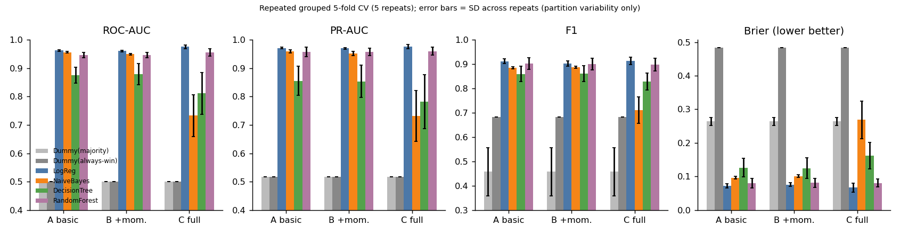

**Uncertainty from the small number of matches.** Match-cluster bootstrap 95% intervals (repeat 0) are wide and overlap across the better models: for set A the ROC-AUC interval is 0.912–0.994 for logistic regression, 0.865–0.994 for Random Forest, 0.901–0.992 for Naive Bayes and 0.752–0.965 for the Decision Tree; for set A logistic regression the accuracy interval is 0.837–0.958. Logistic regression, Random Forest and (on sets A and B) Naive Bayes cannot be separated reliably; the single Decision Tree is the weakest and the least stable. Match-weighted metrics are similar to row-level ones (set A logistic regression: accuracy 0.912, ROC-AUC 0.969, Brier 0.068), so the row-level numbers are not merely an artefact of long chases.

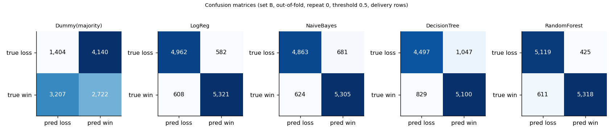

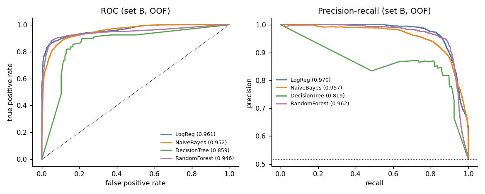

**Trade-offs.** Logistic regression has the best Brier score and AUC with almost no variance across repeats and is directly interpretable; the strong linear fit is plausible because win probability is a smooth function of required rate, wickets and balls left. Random Forest has slightly higher precision than logistic regression on sets A and B but lower recall and more partition-to-partition variability (Brier SD 0.013 vs 0.006). Naive Bayes is competitive on numeric features but its independence assumption is badly violated by the strongly correlated state variables (its probabilities are the worst calibrated: Brier 0.096–0.101 on A/B) and it fails once one-hot context columns are added (AUC 0.733 on set C). The Decision Tree is interpretable but unstable. Accuracy alone would hide these differences, which is why Brier, AUC and PR-AUC are reported.

## 5.3 Ablation: do momentum and context help?

Paired match-cluster bootstrap of the change in ROC-AUC / Brier (mean and 95% interval):

| Model | B vs A (+momentum) ΔAUC | B vs A ΔBrier | C vs B (+context) ΔAUC | C vs B ΔBrier |
|---|---|---|---|---|
| Logistic regression | −0.001 (−0.003, 0.001) | +0.002 (−0.002, 0.005) | +0.008 (−0.034, 0.053) | +0.005 (−0.050, 0.057) |
| Naive Bayes | −0.006 (−0.020, 0.013) | +0.004 (−0.025, 0.028) | −0.214 (−0.357, −0.073) | +0.174 (0.055, 0.294) |
| Decision Tree | −0.009 (−0.025, −0.001) | +0.006 (0.000, 0.018) | −0.023 (−0.153, 0.126) | +0.034 (−0.071, 0.133) |
| Random Forest | −0.000 (−0.006, 0.006) | +0.001 (−0.004, 0.007) | +0.016 (−0.007, 0.050) | −0.000 (−0.018, 0.016) |

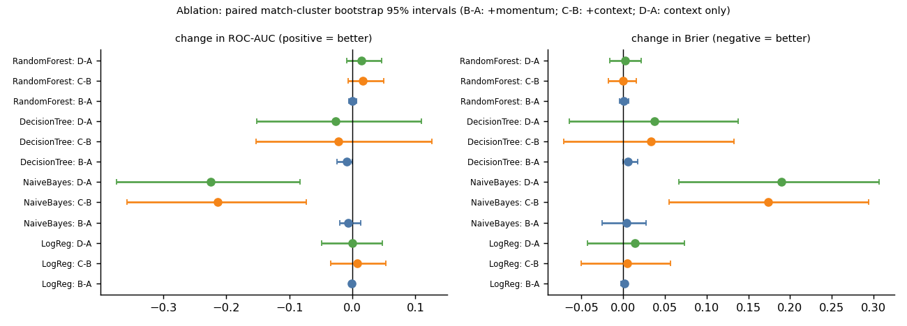

* **Momentum features gave no measurable improvement** in any model on this dataset; the point estimates are zero or slightly negative (the Decision Tree is marginally worse). A likely reason, not tested here, is that required rate, run-rate difference and wickets already capture most of the information the recent-window features carry. Part of the importance that tree models assign to `rate_last30_minus_rrr` (Gini 0.124) reflects its correlation with those variables.
* **Context features (venue, team names, toss) are inconclusive**: intervals for logistic regression and Random Forest include zero. They clearly hurt Naive Bayes and the Decision Tree. Random Forest shows higher stage-wise AUC with context in the early and middle innings (e.g. 0.913 → 0.931 in the first 20% of the chase and 0.945 → 0.967 at 40–60%), but this is not supported at the match-bootstrap level. With 10 teams and 47 matches, team identity features invite memorisation and I do not claim they help. The permutation-importance ranking (below) puts batting team only slightly below target, but with a fold-to-fold SD larger than its mean.
* Set C's logistic regression has the best point estimates (AUC 0.975, Brier 0.067), but given the above I would treat the simpler basic-state logistic regression (A) as the defensible choice, and Random Forest as similar in performance.

## 5.4 Performance across the innings and at fixed checkpoints

Row-level Random Forest AUC by share of the chase completed (set A) rises from 0.917 (0–20%) to 0.938 (40–60%), 0.993 (60–80%) and 1.000 (80–100%). The checkpoint evaluation (set B, one state per still-live chase) gives:

| Over | Matches (wins) | Logistic regression: acc / AUC / Brier | Random Forest: acc / AUC / Brier |
|---|---|---|---|
| 10 | 47 (24) | 0.894 / 0.944 / 0.088 | 0.872 / 0.920 / 0.108 |
| 20 | 46 (24) | 0.870 / 0.947 / 0.099 | 0.913 / 0.934 / 0.086 |
| 30 | 41 (22) | 0.902 / 0.983 / 0.060 | 0.976 / 0.978 / 0.034 |
| 40 | 30 (15) | 0.933 / 0.996 / 0.031 | 0.967 / 0.991 / 0.030 |
| 45 | 16 (9) | 1.000 / 1.000 / 0.010 | 0.938 / 1.000 / 0.035 |

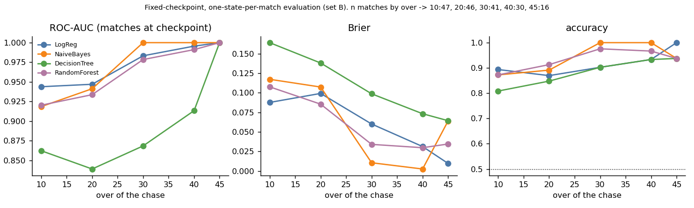

Performance improves as the chase progresses, as expected, but the checkpoint sample sizes are small (the number of live chases falls to 16 by over 45), so the perfect scores at overs 40–45 are not meaningful evidence of near-perfect prediction. That the model already ranks chases well at over 10 (AUC about 0.92–0.94 on 47 matches) is largely driven by the target and required rate; with so few matches this is an exploratory number with a wide interval, not a claim that outcomes are predictable that early.

## 5.5 Calibration

Set B, 5 repeats, Brier: logistic regression 0.076, Random Forest 0.081 (SD 0.013), Random Forest + Platt scaling 0.085 (SD 0.006), Naive Bayes 0.101. Platt scaling reduced the variability across repeats but did not improve the Brier score (and slightly lowered AUC, 0.942 vs 0.946), so no calibrated model is recommended over the raw ones. The reliability curves (Figure 10) show that most predictions are near 0 or 1, and that in the mid range (about 0.4–0.9) the models deviate from the diagonal in both directions with large noise, because few rows fall there.

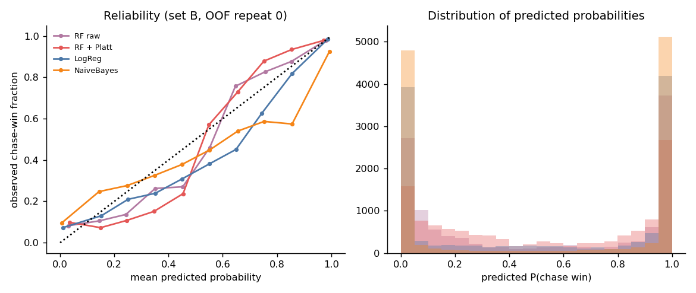

## 5.6 Feature importance and interpretable rules

Permutation importance (Random Forest, set C, mean drop in held-out ROC-AUC over 5 folds): required run rate 0.028 (SD 0.034 across folds), run-rate difference 0.022, target 0.014, batting team 0.014, bowling team 0.009, runs required 0.006; all others ≤ 0.002. Impurity importance (set B, fitted on all rows; descriptive only and biased towards continuous features): required run rate 0.27, target 0.18, run-rate difference 0.175, last-30-ball rate minus required rate 0.12. Permutation scores understate the importance of correlated features and the fold SDs are large, so only the broad message is reliable: the required rate and its relation to the current rate dominate. A depth-3 tree fitted on all rows (descriptive, not an evaluated model; `results/decision_tree_depth3_rules.txt`) splits first on required rate (about 5.7 runs per over).

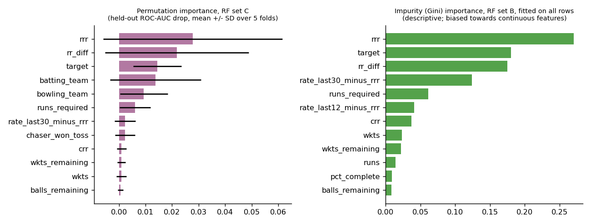

## 5.7 Probability trajectories and worked example

Figure 12a shows the out-of-fold predicted probability through every chase (Random Forest, set B). **The probabilities below are verified out-of-fold model outputs** (the model that produced each number was trained without that match). The reading of each trajectory is illustrative commentary, not additional evidence.

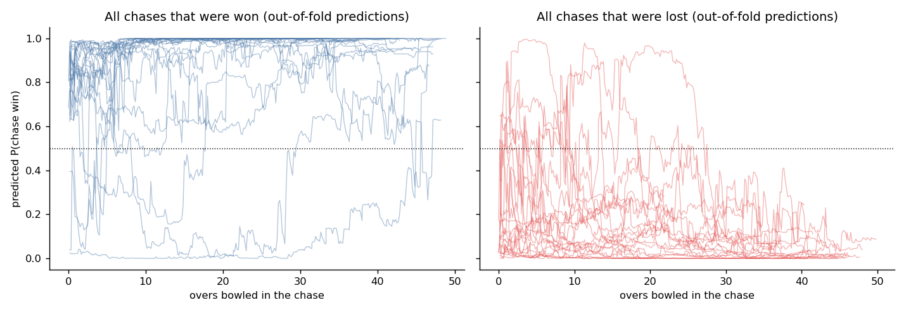

| Match | Over | Score | Wkts left | Runs req. | Balls left | Req. rate | Runs last 12 balls | Pred. P(win) | Actual |
|---|---|---|---|---|---|---|---|---|---|
| 8 Pakistan v Sri Lanka | 10 | 48/2 | 8 | 297 | 240 | 7.43 | 11 | 0.000 | chase won |
| | 20 | 110/2 | 8 | 235 | 180 | 7.83 | 15 | 0.005 | chase won |
| | 30 | 182/2 | 8 | 163 | 120 | 8.15 | 24 | 0.039 | chase won |
| | 40 | 271/3 | 7 | 74 | 60 | 7.40 | 11 | 0.234 | chase won |
| | 45 | 314/4 | 6 | 31 | 30 | 6.20 | 20 | 0.630 | chase won |
| 29 England v India | 10 | 40/4 | 6 | 190 | 240 | 4.75 | 7 | 0.374 | chase lost |
| | 20 | 68/5 | 5 | 162 | 180 | 5.40 | 4 | 0.223 | chase lost |
| | 30 | 101/8 | 2 | 129 | 120 | 6.45 | 3 | 0.049 | chase lost |

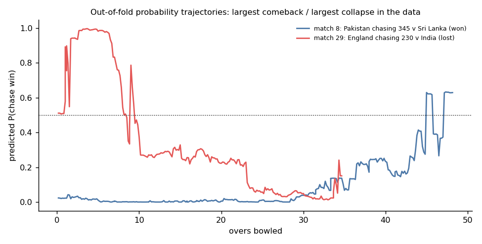

Match 8 is the largest comeback in the data and an instructive failure: the model gave essentially zero probability to a chase of 345 that was in fact won. Of the 13 chases in the tournament with a target of 340 or more, 12 were lost and match 8 is the only success, so training folds contained almost no successful chases of that size. The model is therefore overconfident at extremes, which matters for any use of its probabilities, and this is a consequence of very few observations rather than a general feature of cricket. Match 29 shows the more typical pattern: probability decays as wickets fall and the run rate lags.

## 5.8 Sanity checks and sensitivity

* **Shuffled outcomes.** With match outcomes randomly permuted across matches (5 shuffles, logistic regression, set B), accuracy was 0.45–0.64, ROC-AUC 0.42–0.65 and Brier 0.25–0.30, i.e. chance level, so the pipeline does not produce high scores from structure unrelated to the true outcome.
* **Dropping match 15** (the 43-over match whose limit was inferred from the data): results are essentially unchanged (set A logistic regression accuracy 0.913, AUC 0.961, Brier 0.073; Random Forest 0.914, 0.956, 0.070).

## 5.9 Data engineering and the Spark question

The full pandas pipeline (load, clean, validate, build all chase states) took a median of 0.50 s (7 runs, range 0.41–0.63 s) on a single-core sandbox. **A Spark implementation (`src/spark_pipeline.py`) was written but not run**: PySpark was not installed and there was no network access. No Spark timing exists and none is claimed. For a 3.7 MB file Spark's start-up cost would be expected to exceed any benefit, but this is an expectation, not a measurement; the script includes a replicated-data stress option for running the comparison elsewhere.

# 6. Discussion

The data support a modest, clear message: in this tournament the eventual outcome of a chase is predicted well by the basic match state (required rate, wickets, balls left, target); logistic regression and Random Forest both reach about 0.90 accuracy, 0.95–0.97 ROC-AUC and Brier 0.07–0.08 under match-wise validation. The additional recent-scoring features did not improve any model measurably, and context features were inconclusive. Association rules recover the intuitive structure (low required rate with wickets in hand → win; high required rate with fewer wickets → loss), but largely because the discretised inputs restate the quantities that decide a chase; they are best viewed as an explanation of the classifier's behaviour, not as independent knowledge. The results rest on 47 matches: intervals are wide, the models are statistically hard to separate, and row-level metrics are dominated by late, easy states.

# 7. Limitations

* 47 usable matches from one tournament; match-level uncertainty is large and the findings may not generalise to other tournaments, pitches or eras.
* Rows within a chase are dependent; row-level metrics weight long chases more heavily. Match-weighted and checkpoint views mitigate but do not remove this.
* Match 35 (DLS) is excluded because its revised target is not in the data; match 15's overs limit is inferred from the data (sensitivity check unchanged). Boundaries are approximated by 4s and 6s.
* No ball-level information about batters, bowlers, pitch or weather beyond what is in the three files; team identity features risk memorising 10 teams.
* Association rules are mined on all matches (descriptive, no held-out check), are dominated by redundant nested rules, and are not causal.
* Random Forest hyper-parameters were fixed a priori and not tuned; Naive Bayes is Gaussian; the decision threshold was not tuned; probabilities are overconfident at extremes (match 8).
* The Spark comparison was not run; Apriori and FP-Growth are own implementations, so their speed ratio does not transfer to mlxtend.
* The notebook has no stored outputs; the scripts were executed and the logs are in `results/run_log.txt`.

# 8. Future work

Add other tournaments (not allowed here) to test generalisation; model the chase as a survival or hazard process; use resource-based features inspired by DLS; include batter-level context (batter at the crease, partnership length); test rule-derived features with a properly nested experiment; and run the Spark benchmark on a replicated or much larger ball-by-ball corpus.

# 9. Conclusion

A leakage-safe, match-grouped pipeline for ODI chase prediction was built and evaluated on the 2023 World Cup data. Basic match state already gives strong, well-ranked predictions; momentum features added no measurable value here; association rules provide an interpretable but largely arithmetic description of winning and losing states. All figures are exploratory estimates from 47 matches.

# 10. Reproducibility

See `README.md`. Run `python src/run_experiments.py` then `python src/make_figures.py`; seeds are fixed; versions are in `requirements.txt`.

# References

Agrawal, R., & Srikant, R. (1994). Fast algorithms for mining association rules. *Proc. VLDB*.

Brier, G. W. (1950). Verification of forecasts expressed in terms of probability. *Monthly Weather Review*, 78(1).

Breiman, L. (2001). Random forests. *Machine Learning*, 45(1).

Duckworth, F. C., & Lewis, A. J. (1998). A fair method for resetting the target in interrupted one-day cricket matches. *Journal of the Operational Research Society*, 49(3).

Han, J., Pei, J., & Yin, Y. (2000). Mining frequent patterns without candidate generation. *Proc. ACM SIGMOD*.

Pedregosa, F., et al. (2011). Scikit-learn: Machine learning in Python. *JMLR*, 12.

Platt, J. (1999). Probabilistic outputs for support vector machines and comparisons to regularized likelihood methods. *Advances in Large Margin Classifiers*.

Roberts, D. R., et al. (2017). Cross-validation strategies for data with temporal, spatial, hierarchical, or phylogenetic structure. *Ecography*, 40(8).
